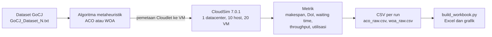
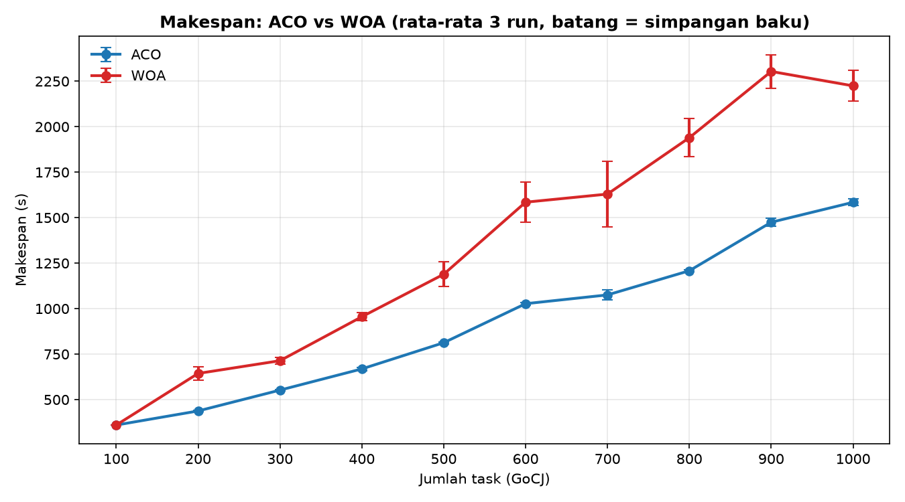
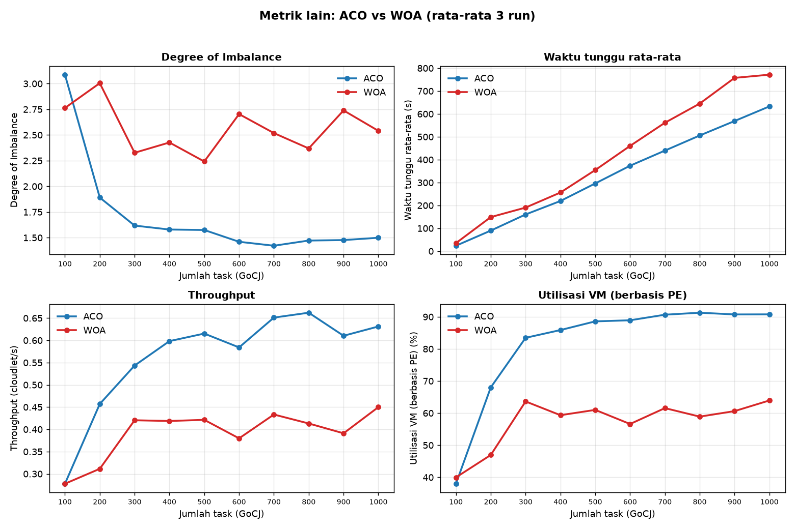

# SimulasiACO_WOA: Perbandingan Ant Colony Optimization dan Whale Optimization Algorithm untuk Penjadwalan Tugas pada Lingkungan Cloud (CloudSim)

<p align="center">
  
  
  
  <br>
  
  
  
  
  
</p>

Proyek tugas mata kuliah **Strategi Optimasi Kerja Awan**. Dua algoritma metaheuristik, **Ant Colony Optimization (ACO)** dan **Whale Optimization Algorithm (WOA)**, diterapkan pada **CloudSim 7.0.1** untuk menentukan VM tempat setiap Cloudlet dijalankan, lalu dibandingkan menggunakan dataset **GoCJ** pada 100 sampai 1000 task.

## Daftar Isi

1. [Latar Belakang dan Tujuan](#1-latar-belakang-dan-tujuan)
2. [Tech Stack](#2-tech-stack)
3. [Alur Eksperimen](#3-alur-eksperimen)
4. [Konfigurasi Simulasi](#4-konfigurasi-simulasi)
5. [Algoritma dan Metrik](#5-algoritma-dan-metrik)
6. [Struktur Repository](#6-struktur-repository)
7. [Instalasi dan Menjalankan](#7-instalasi-dan-menjalankan)
8. [Hasil Eksperimen](#8-hasil-eksperimen)
9. [Reproducibility dan Troubleshooting](#9-reproducibility-dan-troubleshooting)
10. [Kredit, Lisensi, dan Referensi](#10-kredit-lisensi-dan-referensi)

## 1. Latar Belakang dan Tujuan

Penjadwalan tugas (*task scheduling*) pada cloud menentukan VM mana yang mengeksekusi setiap tugas. Pemetaan yang buruk membuat sebagian VM menumpuk antrean sementara VM lain menganggur, sehingga waktu selesai total (makespan) membesar. Masalah ini bersifat NP-hard, sehingga pendekatan metaheuristik banyak dipakai untuk mencari pemetaan yang baik dalam waktu wajar.

Tujuan proyek ini:

- Menerapkan **ACO** dan **WOA** pada simulasi CloudSim dengan konfigurasi infrastruktur yang sama.
- Membandingkan keduanya pada workload **100 sampai 1000 task** (kelipatan 100), masing-masing **3 run** per ukuran.
- Menyajikan hasil dalam bentuk CSV, workbook Excel dengan grafik, dan log setiap run yang dapat direproduksi.

Kedua algoritma dikerjakan, tetapi hanya satu yang dipresentasikan.

## 2. Tech Stack

| Lapisan | Teknologi | Fungsi |
| --- | --- | --- |
| Simulator | CloudSim 7.0.1 | Simulasi datacenter, host, VM, dan eksekusi Cloudlet |
| Bahasa | Java 21 (OpenJDK) | Implementasi ACO, WOA, dan program simulasi |
| Build | Apache Maven 3.9.x | Kompilasi dan eksekusi (`mvn exec:java`) |
| Algoritma | ACO dan WOA (implementasi sendiri) | Mencari pemetaan Cloudlet ke VM |
| Dataset | GoCJ (Google Cloud Jobs) | Panjang job dalam MI, satu file per ukuran |
| Otomasi | PowerShell (`run_all.ps1`), Bash (`run_all.sh`) | Menjalankan 60 run secara berurutan |
| Analisis | Python 3, openpyxl | Membangun workbook Excel (rumus dan grafik) |
| Visualisasi README | Python 3, pandas, matplotlib | Membuat gambar grafik dari CSV |

## 3. Alur Eksperimen



Algoritma hanya menentukan pemetaan. Pemetaan itu kemudian diikat ke setiap Cloudlet melalui `DatacenterBroker` (`setGuestId`) sebelum simulasi dijalankan, dan semua metrik yang dilaporkan berasal dari hasil simulasi CloudSim.

## 4. Konfigurasi Simulasi

| Komponen | Konfigurasi |
| --- | --- |
| Datacenter | 1 |
| Host | 10 (5 Class A: 4 core, 2000 MIPS/core, 8 GB RAM; 5 Class B: 8 core, 3000 MIPS/core, 16 GB RAM) |
| VM | 20, heterogen (4 tipe x 5 VM) |
| VM Type 1 | 1 core, 1000 MIPS, 2 GB RAM |
| VM Type 2 | 2 core, 1500 MIPS, 2 GB RAM |
| VM Type 3 | 2 core, 2000 MIPS, 4 GB RAM |
| VM Type 4 | 4 core, 2500 MIPS, 4 GB RAM |
| Scheduler VM | `CloudletSchedulerSpaceShared` |
| Cloudlet | 100 sampai 1000 (kelipatan 100), 1 PE per Cloudlet |
| Dataset | `GoCJ_Dataset_100.txt` sampai `GoCJ_Dataset_1000.txt` (satu file per ukuran, masing-masing sampel tersendiri) |
| Run per ukuran | 3 (seed 1, 2, 3) |
| Total run | 2 algoritma x 10 ukuran x 3 run = 60 |

## 5. Algoritma dan Metrik

### 5.1 Fitness (sama untuk ACO dan WOA)

Setiap solusi adalah pemetaan Cloudlet ke VM. Fitness dihitung dengan meniru antrean `CloudletSchedulerSpaceShared` (VM dengan p core menjalankan p Cloudlet paralel, antrean FIFO sesuai urutan id Cloudlet):

```
fitness = makespan + 0.001 x rata-rata waktu selesai Cloudlet
```

Makespan adalah tujuan utama. Suku kedua (bobot 0,1%) hanya pemecah seri: pada jumlah task kecil, satu Cloudlet terbesar (900.000 MI di VM tercepat 2500 MIPS = 360 s) sudah menentukan makespan sehingga banyak solusi bernilai sama. Estimasi fitness divalidasi terhadap hasil simulasi CloudSim: 55 dari 60 run selisihnya paling banyak 0,1 s, dan selisih terbesar 2,7 s (0,62%) akibat pembulatan waktu antar-event CloudSim pada antrean panjang. Makespan yang dilaporkan selalu hasil simulasi CloudSim, bukan estimasi.

### 5.2 ACO

Setiap semut membangun jadwal Cloudlet demi Cloudlet. Peluang memilih VM j untuk Cloudlet i:

```
p(i,j) ~ tau(i,j)^alpha x eta(i,j)^beta
eta(i,j) = 1 / (waktu selesai Cloudlet i jika ditaruh di VM j)
```

`eta` memperhitungkan kecepatan VM sekaligus antrean yang sudah terbentuk. Feromon diperbarui dengan penguapan, lalu deposit dari semut terbaik iterasi dan semut terbaik global (elitist), dengan batas bawah dan atas feromon.

| Parameter | Nilai |
| --- | --- |
| Semut | 30 |
| Iterasi | 100 |
| alpha / beta | 1 / 2 |
| rho (penguapan) | 0.3 |
| Q | 1.0 |
| tau awal / min / max | 1.0 / 0.01 / 2Q/rho |

### 5.3 WOA

Setiap paus adalah vektor posisi kontinu berdimensi N (satu elemen per Cloudlet) pada rentang [0, 20). Posisi didekode menjadi indeks VM dengan `floor()`. Memakai tiga perilaku WOA standar (Mirjalili dan Lewis, 2016): mengepung mangsa, mencari mangsa, dan gerakan spiral.

| Parameter | Nilai |
| --- | --- |
| Paus | 30 |
| Iterasi | 100 |
| b (bentuk spiral) | 1 |

Iterasi pertama mengevaluasi populasi awal, sehingga **kedua algoritma memakai 3000 evaluasi fitness** (perbandingan yang adil).

### 5.4 Metrik

| Metrik | Definisi |
| --- | --- |
| Makespan | Waktu selesai terakhir hasil simulasi CloudSim |
| Degree of Imbalance (DoI) | (beban maks - beban min) / beban rata-rata antar VM |
| Average Waiting Time | Rata-rata waktu mulai eksekusi Cloudlet |
| Throughput | Jumlah Cloudlet / makespan |
| Average VM Utilization | Total waktu CPU Cloudlet / (makespan x 45 total PE seluruh VM), maksimum 100% |

**Catatan utilisasi:** rumus utilisasi pada implementasi MET lama membagi dengan (makespan x jumlah VM). Pada jadwal yang seimbang, rumus itu bisa melebihi 100% karena VM multi-core menjalankan beberapa Cloudlet paralel. Karena itu proyek ini memakai total PE sebagai pembagi. Nilai dengan rumus lama tetap disimpan di kolom `Utilization MET Formula (%)`.

## 6. Struktur Repository

```
.
├── README.md
├── pom.xml
├── dataset/
│   └── GoCJ_Dataset_100.txt ... GoCJ_Dataset_1000.txt   (10 file)
├── docs/
│   └── charts/
│       ├── makespan.png
│       └── metrics-overview.png
├── modules/
│   ├── cloudsim/
│   └── cloudsim-examples/
│       └── src/main/java/org/cloudbus/cloudsim/examples/
│           ├── ACO_TaskScheduling.java
│           └── WOA_TaskScheduling.java
├── scripts/
│   ├── run_all.sh              # runner 60 run (Linux/macOS/Git Bash)
│   ├── run_all.ps1             # runner 60 run (Windows PowerShell)
│   ├── build_workbook.py       # membangun file Excel dari CSV
│   └── make_readme_charts.py   # membuat gambar grafik README dari CSV
└── results/
    ├── aco_raw.csv
    ├── woa_raw.csv
    ├── ACO_WOA_Results.xlsx
    └── logs/                   # output konsol setiap run
```

## 7. Instalasi dan Menjalankan

### 7.1 Persyaratan

- JDK 21 (`java -version`)
- Apache Maven 3.9.x (`mvn -version`), dijalankan dengan JDK 21
- Python 3 dengan `openpyxl` (workbook), serta `pandas` dan `matplotlib` (gambar README)

### 7.2 Build

Dari **root repository** (folder yang berisi `pom.xml`):

```
mvn clean install
```

Program membaca dataset lewat path relatif `dataset/GoCJ_Dataset_<jumlahTask>.txt` (misalnya 200 task membaca `GoCJ_Dataset_200.txt`), sehingga selalu dijalankan dari root repository.

### 7.3 Menjalankan satu simulasi

Argumen: `jumlahTask run seed fileCsv`. Tanpa argumen program memakai 1000 task, run 1, seed 1, dan menulis ke `results/aco_manual.csv` atau `results/woa_manual.csv` (file ini diabaikan Git, aman untuk demo).

```
mvn exec:java -pl modules/cloudsim-examples/ -Dexec.mainClass=org.cloudbus.cloudsim.examples.ACO_TaskScheduling

mvn exec:java -pl modules/cloudsim-examples/ -Dexec.mainClass=org.cloudbus.cloudsim.examples.WOA_TaskScheduling
```

Contoh dengan argumen (200 task, run 2, seed 2):

```
mvn exec:java -pl modules/cloudsim-examples/ -Dexec.mainClass=org.cloudbus.cloudsim.examples.ACO_TaskScheduling "-Dexec.args=200 2 2 results/contoh.csv"
```

Hasil acuan untuk memeriksa lingkungan: ACO, 1000 task, seed 1 menghasilkan makespan **1565.2558 s** dan utilisasi **91.5233 %**.

### 7.4 Menjalankan seluruh eksperimen (60 run)

Windows PowerShell:

```
powershell -ExecutionPolicy Bypass -File scripts\run_all.ps1
```

Linux/macOS/Git Bash:

```
scripts/run_all.sh
```

Opsi: pilih satu algoritma (`-Algo aco` atau `-Algo woa` di PowerShell, `aco` atau `woa` di Bash) dan `-Force`/`--force` untuk menimpa hasil lama. Tanpa opsi force, skrip berhenti bila CSV sudah ada agar hasil tidak tertimpa tanpa sengaja.

Hasil: `results/aco_raw.csv`, `results/woa_raw.csv`, dan log tiap run di `results/logs/`.

### 7.5 Membangun file Excel dan gambar grafik

```
pip install openpyxl pandas matplotlib
python scripts/build_workbook.py
python scripts/make_readme_charts.py
```

`build_workbook.py` menghasilkan `results/ACO_WOA_Results.xlsx` dengan sheet **Raw Results** (semua run), **Average Results** (rata-rata, simpangan baku makespan, dan perbandingan ACO vs WOA, semuanya rumus), dan **Charts** (6 grafik ACO vs WOA). `make_readme_charts.py` menghasilkan dua gambar di `docs/charts/` yang ditampilkan pada bagian hasil di bawah.

## 8. Hasil Eksperimen

Rata-rata 3 run per ukuran (seed 1, 2, 3) pada dataset GoCJ. Angka berikut berasal dari run di komputer penyusun dan sama dengan isi `results/ACO_WOA_Results.xlsx`.

### 8.1 Makespan

Nilai ditulis sebagai rata-rata ± simpangan baku antar 3 run. Kolom terakhir adalah selisih relatif (WOA - ACO) / WOA.

| Tasks | ACO Makespan (s) | WOA Makespan (s) | ACO lebih rendah (%) |
|---:|---:|---:|---:|
| 100 | 360.08 ± 0.12 | 360.01 ± 0.00 | -0.0 |
| 200 | 437.58 ± 3.27 | 643.82 ± 37.11 | 32.0 |
| 300 | 552.16 ± 3.47 | 713.79 ± 17.19 | 22.6 |
| 400 | 668.67 ± 8.75 | 955.51 ± 22.75 | 30.0 |
| 500 | 812.68 ± 5.52 | 1189.01 ± 67.51 | 31.7 |
| 600 | 1027.17 ± 6.59 | 1585.07 ± 111.20 | 35.2 |
| 700 | 1075.43 ± 26.90 | 1629.64 ± 181.96 | 34.0 |
| 800 | 1208.26 ± 5.42 | 1939.56 ± 103.92 | 37.7 |
| 900 | 1474.86 ± 21.24 | 2303.74 ± 92.25 | 36.0 |
| 1000 | 1584.50 ± 19.18 | 2224.56 ± 85.25 | 28.8 |




### 8.2 Metrik lain

| Tasks | ACO DoI | WOA DoI | ACO Waiting (s) | WOA Waiting (s) |
|---:|---:|---:|---:|---:|
| 100 | 3.09 | 2.76 | 23.82 | 35.24 |
| 200 | 1.89 | 3.00 | 89.98 | 148.97 |
| 300 | 1.62 | 2.33 | 160.47 | 190.64 |
| 400 | 1.58 | 2.43 | 219.37 | 256.36 |
| 500 | 1.57 | 2.24 | 296.09 | 354.68 |
| 600 | 1.46 | 2.70 | 373.52 | 460.20 |
| 700 | 1.42 | 2.52 | 439.65 | 561.38 |
| 800 | 1.47 | 2.37 | 505.71 | 645.25 |
| 900 | 1.48 | 2.74 | 568.89 | 757.52 |
| 1000 | 1.50 | 2.54 | 632.81 | 771.53 |


| Tasks | ACO Throughput (cloudlet/s) | WOA Throughput (cloudlet/s) | ACO Utilisasi (%) | WOA Utilisasi (%) |
|---:|---:|---:|---:|---:|
| 100 | 0.2777 | 0.2778 | 37.98 | 39.96 |
| 200 | 0.4571 | 0.3113 | 68.01 | 46.95 |
| 300 | 0.5434 | 0.4204 | 83.46 | 63.63 |
| 400 | 0.5983 | 0.4188 | 85.87 | 59.34 |
| 500 | 0.6153 | 0.4214 | 88.58 | 61.00 |
| 600 | 0.5841 | 0.3798 | 88.92 | 56.60 |
| 700 | 0.6512 | 0.4333 | 90.65 | 61.55 |
| 800 | 0.6621 | 0.4132 | 91.28 | 58.90 |
| 900 | 0.6103 | 0.3911 | 90.74 | 60.62 |
| 1000 | 0.6312 | 0.4500 | 90.76 | 63.93 |




### 8.3 Waktu penjadwalan

Waktu yang dibutuhkan algoritma untuk menentukan pemetaan (belum termasuk simulasi CloudSim). Nilai ini bergantung pada komputer.

| Tasks | ACO (ms) | WOA (ms) |
|---:|---:|---:|
| 100 | 57.9 | 17.1 |
| 200 | 88.7 | 31.1 |
| 300 | 118.1 | 48.4 |
| 400 | 144.2 | 44.7 |
| 500 | 176.1 | 56.4 |
| 600 | 200.2 | 62.2 |
| 700 | 225.1 | 68.7 |
| 800 | 258.1 | 64.7 |
| 900 | 282.7 | 68.1 |
| 1000 | 319.6 | 75.6 |


### 8.4 Temuan

- **Makespan:** ACO menghasilkan makespan lebih rendah daripada WOA pada 9 dari 10 ukuran. Pada 200 sampai 1000 task, ACO lebih rendah 22,6% sampai 37,7% (pada 1000 task: 28,8%). Pada 100 task keduanya sekitar 360 s karena makespan sudah mencapai batas bawah teoretis (job terbesar 900.000 MI di VM tercepat 2500 MIPS).
- **Metrik lain:** waktu tunggu ACO lebih rendah di seluruh 10 ukuran. Throughput dan utilisasi ACO lebih tinggi di 200 sampai 1000 task. Degree of Imbalance ACO lebih rendah di 200 sampai 1000 task, tetapi lebih tinggi pada 100 task (3,09 vs 2,76). Utilisasi ACO berada di 83,5% sampai 91,3% pada 300 sampai 1000 task, sedangkan WOA 56,6% sampai 63,9%.
- **Konsistensi antar run:** simpangan baku makespan WOA mencapai 182 s (pada 700 task), sedangkan ACO maksimum 27 s. Pola ini konsisten dengan kecenderungan WOA standar berpengodean posisi kontinu untuk mengalami konvergensi dini pada masalah diskret berdimensi tinggi (N dimensi); hal ini belum diuji lebih jauh. Pada uji pendahuluan di 1000 task, menaikkan iterasi WOA 10 kali tidak memperbaiki hasilnya secara berarti.
- **Waktu penjadwalan:** ACO membutuhkan 58 sampai 320 ms dan WOA 17 sampai 76 ms per run (diukur di komputer penyusun). ACO sekitar 4,2 kali lebih lambat pada 1000 task karena membangun solusi untuk setiap semut. Keduanya sangat kecil dibandingkan makespan hasil simulasi.
- **Kurva tidak selalu monoton:** setiap ukuran memakai file GoCJ yang berbeda (sampel tersendiri, bukan potongan dari file yang lebih besar), sehingga kenaikan makespan antar ukuran tidak harus mulus.

## 9. Reproducibility dan Troubleshooting

Dengan seed yang sama, makespan, degree of imbalance, waiting time, throughput, dan utilisasi bersifat **deterministik**: hasil di komputer penyusun identik dengan hasil di komputer lain. Hanya kolom `Scheduling Time (ms)` yang bergantung pada kecepatan komputer. Jangan mengubah dataset, jumlah host/VM, parameter algoritma, atau seed tanpa mencatatnya sebagai eksperimen baru.

| Masalah | Penyebab dan solusi |
| --- | --- |
| `Dataset file not found` | Jalankan dari root repository dan pastikan `dataset/GoCJ_Dataset_<jumlahTask>.txt` ada (10 file, 100 sampai 1000). |
| `mvn` tidak dikenali | Periksa instalasi Maven dan `PATH`, lalu jalankan `mvn -version`. |
| Main class tidak ditemukan | Pastikan file berada di `modules/cloudsim-examples/src/main/java/org/cloudbus/cloudsim/examples/`, lalu jalankan ulang `mvn clean install`. |
| Angka desimal berkoma di CSV | Tidak terjadi: program memakai `Locale.ROOT` sehingga selalu titik desimal. |
| Sel Excel kosong di pratinjau (GitHub, Drive, HP) | File dibuat tanpa nilai hasil hitung tersimpan. Buka di Excel lalu simpan ulang (Ctrl+S). |

## 10. Kredit, Lisensi, dan Referensi

### 10.1 Kredit

Proyek ini memakai karya pihak lain:

| Komponen | Pencipta | Catatan |
| --- | --- | --- |
| **CloudSim 7.0.1** | CLOUDS Laboratory, University of Melbourne | Source di `modules/` berasal dari CloudSim 7.0.1 (<https://github.com/Cloudslab/cloudsim>). Setiap file source CloudSim membawa header hak cipta University of Melbourne beserta keterangan lisensinya (GPL); header tersebut dipertahankan dan tidak boleh dihapus. |
| **Dataset GoCJ** | Altaf Hussain dan Muhammad Aleem | Dipakai apa adanya, satu file per ukuran. Ketentuan lisensi dataset dapat dilihat di halaman Mendeley Data (DOI di bawah). |
| **Algoritma ACO dan WOA** | Dorigo dkk.; Mirjalili dan Lewis | Gagasan algoritma berasal dari publikasi di bagian referensi. Implementasi Java untuk CloudSim pada proyek ini dibuat oleh kelompok. |

Bagian yang dibuat khusus untuk tugas ini: `ACO_TaskScheduling.java`, `WOA_TaskScheduling.java`, folder `scripts/`, folder `results/`, dan dokumen ini.

### 10.2 Referensi

- Rodrigo N. Calheiros, Rajiv Ranjan, Anton Beloglazov, Cesar A. F. De Rose, dan Rajkumar Buyya. [CloudSim: A Toolkit for Modeling and Simulation of Cloud Computing Environments and Evaluation of Resource Provisioning Algorithms](http://www.buyya.com/papers/CloudSim2010.pdf). *Software: Practice and Experience*, 41(1), 23-50, 2011.
- Remo Andreoli, Jie Zhao, Tommaso Cucinotta, dan Rajkumar Buyya. [CloudSim 7G: An Integrated Toolkit for Modeling and Simulation of Future Generation Cloud Computing Environments](https://onlinelibrary.wiley.com/doi/10.1002/spe.3413). *Software: Practice and Experience*, 2025.
- Altaf Hussain dan Muhammad Aleem. [GoCJ: Google Cloud Jobs Dataset for Distributed and Cloud Computing Infrastructures](https://doi.org/10.3390/data3040038). *Data*, 3(4), 38, 2018. Dataset: [Mendeley Data, DOI 10.17632/b7bp6xhrcd.1](https://data.mendeley.com/datasets/b7bp6xhrcd/1).
- Marco Dorigo dan Thomas Stutzle. *Ant Colony Optimization*. MIT Press, 2004.
- Seyedali Mirjalili dan Andrew Lewis. The Whale Optimization Algorithm. *Advances in Engineering Software*, 95, 51-67, 2016.
